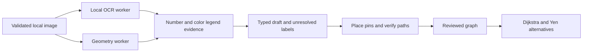

# Engine architecture and extension points

The React shell renders the approved SVG campus or an uploaded raster. It owns temporary object URLs and independent prepared maps. No image is sent to a server or saved across reloads.

| Module                     | Contract                                                                                                                           |
| -------------------------- | ---------------------------------------------------------------------------------------------------------------------------------- |
| `src/engine/index.ts`      | Cancellable browser orchestration; self-hosted OCR; 120-second job bound; disposes workers.                                        |
| `src/engine/imported/`     | Source-derived labels, regions and linework suggestions in input pixels. No title/filename presets; detected edges are unreviewed. |
| `src/engine/core.ts`       | Targeted digit recognition support, conservative neutral linework and approach points on that linework.                            |
| `src/engine/merge.ts`      | Independent X/Y coordinate scaling and evidence merging; conflicts remain unresolved.                                              |
| `src/engine/types.ts`      | OCR observations and analysis report, including reviewable regions.                                                                |
| `src/mapEdges.ts`          | Uploaded-edge origin, pedestrian review and separate accessibility review; authored demo edges stay independent.                   |
| `src/preparedMap.ts`       | Graph operations, publication checks, pin movement and review invalidation; routing refuses drafts or invalid/unreviewed graphs.   |
| `src/MapEditor.tsx`        | Manual corrections, unresolved-label placement, scale/north calibration and publication review.                                    |
| `src/search.ts`            | Shared local search: names/aliases before prefixes/typos; preserve non-Latin vowel marks.                                          |
| `src/routeAlternatives.ts` | Loop-free alternatives from actual graph edges. Never pad results to three with invented routes.                                   |
| `src/locations.ts`         | Exact demo map/version/place resolution for Connect; unavailable or unsupported references cannot reuse a previous route.          |

OCR preparation uses at most 1600 pixels on the long side; geometry uses at most 1000. Original-image coordinates are restored with separate width and height ratios, including rounding. Indoor candidate regions stay in geometry coordinates during corridor extraction, then are scaled for display. Indoor linework and room approaches are suggestions constrained by a detected wall mask; every simplified edge is checked against that mask. The mask can be wrong on a photograph, so it does not establish pedestrian access or accessibility. Candidate regions without labels remain regions, not fabricated room names. Multi-image floor relationships need explicit future data and review; matching stair names are insufficient evidence.

Detected edges carry review metadata into the editor. Pedestrian review is required for publication and accessibility is a separate assertion. Manually drawing a segment confirms pedestrian access; the final map review is still required. Moving an endpoint invalidates both checks on affected edges. See [public contracts and failure behavior](navigation-contracts.md).

To add an extractor, implement a pure candidate function with synthetic tests. Return observations and uncertainty, not authoritative navigation. Run expensive work in the analysis worker, preserve cancellation, and benchmark unknown maps before making accuracy claims. New runtime/model dependencies must stay local and have a reproducible asset manifest.

See [migration decisions](../ENGINE_MIGRATION.md) for source defects excluded from the port and [engine direction](../ENGINE_PLAN.md) for dataset and model evaluation work still needed.
