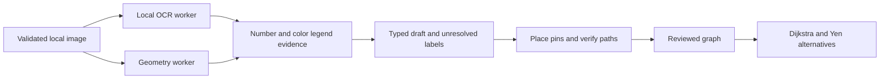

# Engine architecture and extension points

The React shell renders the approved SVG campus or an uploaded raster. It owns temporary object URLs and independent prepared maps. No image is sent to a server or saved across reloads.

| Module                     | Contract                                                                                                    |
| -------------------------- | ----------------------------------------------------------------------------------------------------------- |
| `src/engine/index.ts`      | Cancellable browser orchestration; self-hosted OCR; 120-second job bound; disposes workers.                 |
| `src/engine/imported/`     | Pure, bounded source-derived candidates in input pixels; no network, filenames, inferred edges or UI state. |
| `src/engine/core.ts`       | Targeted digit recognition support, conservative neutral linework and approach points on that linework.     |
| `src/engine/merge.ts`      | Independent X/Y coordinate scaling and evidence merging; conflicts remain unresolved.                       |
| `src/engine/types.ts`      | OCR observations and analysis report, including reviewable regions.                                         |
| `src/preparedMap.ts`       | Graph operations, review checks, pin movement and invalidation of attached accessibility flags.             |
| `src/MapEditor.tsx`        | Manual corrections, unresolved-label placement, scale/north calibration and publication review.             |
| `src/search.ts`            | Shared local search: names/aliases before prefixes/typos; preserve non-Latin vowel marks.                   |
| `src/routeAlternatives.ts` | Loop-free alternatives from actual graph edges. Never pad results to three with invented routes.            |

OCR preparation uses at most 1600 pixels on the long side; geometry uses at most 1000. Original-image coordinates are restored with separate width and height ratios, including rounding. Indoor detection proposes room outlines and labels, not door connectivity. Multi-image floor relationships need explicit future data and review; matching stair names are insufficient evidence.

To add an extractor, implement a pure candidate function with synthetic tests. Return observations and uncertainty, not authoritative navigation. Run expensive work in the analysis worker, preserve cancellation, and benchmark unknown maps before making accuracy claims. New runtime/model dependencies must stay local and have a reproducible asset manifest.

See [migration decisions](../ENGINE_MIGRATION.md) for source defects excluded from the port and [engine direction](../ENGINE_PLAN.md) for dataset and model evaluation work still needed.
